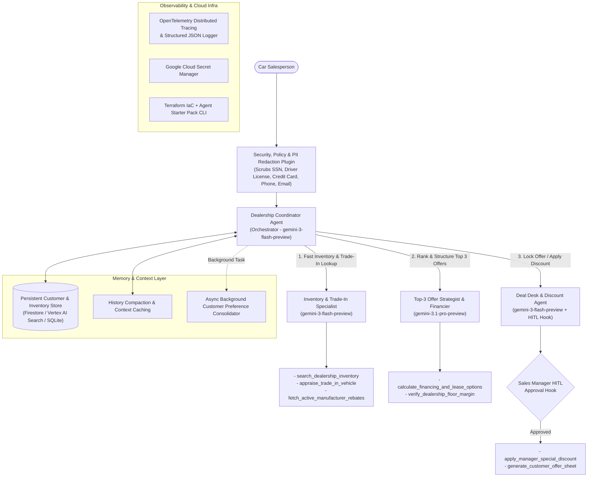

# AutoDeal Copilot — Architecture & Implementation Plan

> **Assessment Target:** AI in 5 Days Assessment Agent (95 / 95 AgentOps Code Review Matrix)
> **Use Case:** Enterprise Car Salesman Top-3 Offer Copilot (`AutoDeal Copilot`)
> **Framework & Models:** Google ADK-Python (`google-adk`), `gemini-3-flash-preview` (Fast Tier), and `gemini-3.1-pro-preview` (Deep Reasoning Pro Tier)

---

## 1. Problem & Solution Statement

* **The Problem:** Dealership salespeople spend too much time while a customer is waiting at the desk trying to cross-reference live lot inventory, customer budget/family needs, trade-in valuation, active manufacturer rebates, and financing/lease rates—often resulting in a generic single quote that fails to close the deal.
* **The Solution (`AutoDeal Copilot`):** An Enterprise Dealership Sales Copilot built with **Google ADK-Python** and deployed on **Google Cloud (Cloud Run / Vertex AI Agent Runtime)**. A salesperson inputs the customer's preferences, budget, and trade-in details, and the agent orchestrates inventory lookup, financing/margin calculation, and strategic reasoning to generate **Top 3 Tailored Vehicle Offers**:
  1. **Best Overall Match** (closest fit to lifestyle, features, and target monthly payment)
  2. **Budget / Value Pick** (lowest total cost of ownership / highest rebate or certified pre-owned value)
  3. **Premium / Upgrade Pick** (higher trim, AWD/hybrid/tech package within stretch budget)

It automatically scrubs customer PII (SSN, credit card, driver's license, phone, email), enforces dealership floor-margin guardrails, and triggers a **Human-in-the-Loop (HITL)** Sales Manager approval hook whenever an offer includes a high-stakes promotional discount.

---

## 2. System Architecture

---

## 3. AgentOps Rubric Mapping (95 / 95 Points)

| Category | Criterion (5 pts each) | Code Location & Evidence |
| :--- | :--- | :--- |
| **1. Tool & Interface Design** | **Comprehensive Tool Docstrings** | `app/tools/inventory_tools.py`, `app/tools/financing_tools.py` — Google-style docstrings with `Args`, `Returns`, `Raises`, and examples on every tool. |
| | **Descriptive Naming** | Verb-noun tool names: `search_dealership_inventory`, `appraise_trade_in_vehicle`, `fetch_active_manufacturer_rebates`, `calculate_financing_and_lease_options`, `verify_dealership_floor_margin`, `apply_manager_special_discount`, `generate_customer_offer_sheet`. |
| | **Explicit JSON Schemas** | `app/tools/schemas.py` — Strict Pydantic `BaseModel` input and output schemas (`extra="forbid"`, regex/numeric bounds). |
| | **Guided Error Handling** | All tools catch validation/domain errors and return `status="error"`, `error_code`, and actionable `recovery_suggestion` instructions to the LLM. |
| **2. Context & Memory** | **Robust System Instructions** | `app/prompts/constitution.py` — Explicit agent constitutions defining persona, truth-in-lending APR rules, floor-margin boundaries, and Top-3 Offer formatting. |
| | **History Compaction** | `app/memory/compaction.py` + `app/agent.py` — Sliding-window token truncation, conversation summarization (`ContextCompactor`), and ADK `EventsCompactionConfig` / `ContextCacheConfig`. |
| | **Persistent Session State** | `app/memory/session_store.py` — Persistent SQLite & Firestore-compatible session and vehicle inventory vector/tag store. |
| | **Async Memory Operations** | `app/memory/async_memory.py` — `AsyncMemoryConsolidator` using `asyncio.create_task` for non-blocking background customer profile consolidation. |
| **3. Orchestration & Logic** | **Multi-Agent Patterns** | `app/agent.py` — Coordinator + Specialist sub-agents (`dealership_coordinator` -> `inventory_specialist`, `top_offers_strategist`, `deal_desk_closer`). |
| | **Strategic Model Routing** | `app/routing/model_router.py` — Routes fast lookups to `gemini-3-flash-preview` and complex multi-constraint Top-3 offer ranking to `gemini-3.1-pro-preview`. |
| | **Guardrails & Policy Plugins** | `app/guardrails/policy_plugin.py` — ADK `BasePlugin` + `before_model_callback`, `after_model_callback`, `before_tool_callback` enforcing safety, floor margin, and self-eval. |
| | **Human-in-the-Loop Hooks** | `app/guardrails/hitl.py` — Explicit HITL confirmation gate (`require_confirmation` / `PENDING_MANAGER_APPROVAL`) on `apply_manager_special_discount` for discounts > $1,500 or near invoice. |
| **4. Observability & Tracing** | **Structured JSON Logging** | `app/observability/logger.py` — `python-json-logger` structured logs with `trace_id`, `span_id`, `severity`, and zero `print()` calls in `app/`. |
| | **Intent vs. Outcome Capture** | `app/observability/logger.py` — Explicit `log_intent()` (`event_type="INTENT"`) before execution and `log_outcome()` (`event_type="OUTCOME"`) after execution. |
| | **Distributed Tracing** | `app/observability/tracing.py` — OpenTelemetry (`TracerProvider`, `start_trace_span`, `traced_operation`) linking spans across agents and tools. |
| | **PII Redaction** | `app/guardrails/pii_redactor.py` — Active `PIIRedactor` scrubbing SSNs, credit cards, driver's licenses, emails, and phones in logs and memory. |
| **5. Infrastructure & CI/CD** | **Automated Evaluation Suites** | `evals/golden_dataset.json`, `evals/run_evals.py`, and 1:1 mirrored `pytest` suite under `tests/`. |
| | **Infrastructure as Code** | `deployment/terraform/` (`main.tf`, `variables.tf`, `outputs.tf`, `iam.tf`, `alerts.tf`), `Dockerfile`, and `agents-cli` / `adk` CLI configuration. |
| | **Secure Secret Management** | `app/config.py` — `SecretManagerClient` fetching secrets from Google Cloud Secret Manager (`google-cloud-secret-manager`) with zero hardcoded keys. |

---

## 4. Phased Delivery Roadmap & 1:1 Mirrored Test Structure

Every source module in `app/` has a 1:1 mirrored unit test file in `tests/` enforced by `pre-commit` (`ruff check`, `ruff format`, and `pytest`):

- [x] **Delivery 1: Foundation, Config, Secret Manager & Observability**
  - `app/config.py` ↔ `tests/test_config.py`
  - `app/guardrails/pii_redactor.py` ↔ `tests/guardrails/test_pii_redactor.py`
  - `app/observability/logger.py` ↔ `tests/observability/test_logger.py`
  - `app/observability/tracing.py` ↔ `tests/observability/test_tracing.py`
- [x] **Delivery 2: Synthetic Cars Catalogue, Persistent Session Store, Compaction & Async Memory**
  - `app/data/synthetic_catalog.py` ↔ `tests/data/test_synthetic_catalog.py`
  - `app/memory/session_store.py` ↔ `tests/memory/test_session_store.py`
  - `app/memory/compaction.py` ↔ `tests/memory/test_compaction.py`
  - `app/memory/async_memory.py` ↔ `tests/memory/test_async_memory.py`
- [ ] **Delivery 3: Strict JSON Schemas & Dealership Tools (With Guided Error Recovery)**
  - `app/tools/schemas.py` ↔ `tests/tools/test_schemas.py`
  - `app/tools/inventory_tools.py` ↔ `tests/tools/test_inventory_tools.py`
  - `app/tools/financing_tools.py` ↔ `tests/tools/test_financing_tools.py`
- [ ] **Delivery 4: Guardrails Plugin & Sales Manager Human-in-the-Loop (HITL) Hook**
  - `app/guardrails/hitl.py` ↔ `tests/guardrails/test_hitl.py`
  - `app/guardrails/policy_plugin.py` ↔ `tests/guardrails/test_policy_plugin.py`
- [ ] **Delivery 5: Multi-Agent Orchestration, Strategic Model Router & Constitutional Prompts**
  - `app/prompts/constitution.py` ↔ `tests/prompts/test_constitution.py`
  - `app/routing/model_router.py` ↔ `tests/routing/test_model_router.py`
  - `app/agent.py` ↔ `tests/test_agent.py`
- [ ] **Delivery 6: Golden Evaluation Suite, Terraform IaC, CI/CD & Cloud Deployment**
  - `evals/golden_dataset.json` & `evals/run_evals.py` ↔ `tests/test_evals.py`
  - `deployment/terraform/`, `Dockerfile`, `.github/workflows/ci_eval.yml`, `README.md` ↔ `tests/test_rubric_compliance.py`
